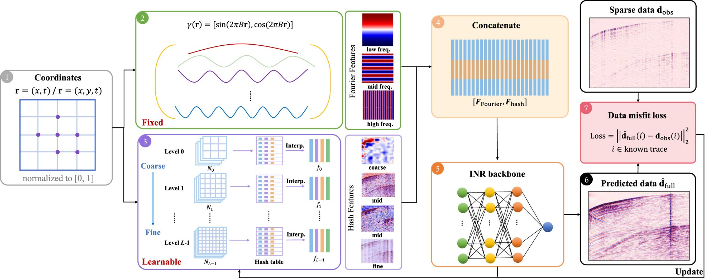

Reproducible material for **Seismic data interpolation using implicit neural
representations with Fourier–hash features**.

**Authors**

Linrong Wang<sup>1</sup>, Omar M. Saad<sup>2,\*</sup>, Shaowen Wang<sup>2</sup>,
Fan Min<sup>1</sup>, Tariq Alkhalifah<sup>2</sup>

<sup>1</sup> School of Sciences, Southwest Petroleum University, Chengdu, 610500, China
<sup>2</sup> Earth Science and Engineering, King Abdullah University of Science and
Technology, Thuwal, Saudi Arabia

Published in *Artificial Intelligence in Geosciences*,
[doi:10.1016/j.aiig.2026.100287](https://doi.org/10.1016/j.aiig.2026.100287).

---

## Scope

This repository provides a self-contained reproduction of the **proposed method** on
one 2D and one 3D example:

| script | example | corresponds to |
|---|---|---|
| `scripts/interpolation_2d.py` | FORGE DAS section, 80% irregular missing traces | Table 1, row `2D / I-80% / Ours`; Fig. 6(g,h) |
| `scripts/interpolation_3d.py` | 3D volume `image3dz`, 80% random missing traces | Table 1, row `3D / 80% / Ours`; Fig. 10 (bottom block, `Ours`) |

The comparison baselines of the paper (*f-x* interpolation, CAFE, MDA-GAN), the regular
sampling case, the 50% missing-rate variants, the New Zealand Parihaka and SEG C3
volumes, and the ablation configurations of Table 2 are **not** included here.

## Project structure

* :open_file_folder: **scripts**: training entry points, the model and the shared configuration;
* :open_file_folder: **data**: the input arrays of the 2D example (the 3D volume is not distributed, see below);
* :open_file_folder: **outputs**: generated checkpoints, figures and reconstructed arrays (git-ignored);
* :open_file_folder: **package**: placeholder for reusable library code;
* :open_file_folder: **asset**: logo.

### Source files

| file | contents |
|---|---|
| `scripts/network.py` | `HybridEncodingMLP` (the proposed model) and `PosEncodingNeRF` (the Fourier branch) |
| `scripts/configure.py` | network width/depth, `omega`, and the hash-grid configuration |
| `scripts/util.py` | path helpers and the coordinate-grid builder |
| `scripts/modules.py` | auxiliary INR building blocks, not used by the two entry points |

## Getting started :space_invader: :robot:

To ensure reproducibility we suggest creating the environment from `environment.yml`:

```bash
./install_env.sh
```

This installs a CUDA 11.8 toolchain and compiles
[tiny-cuda-nn](https://github.com/NVlabs/tiny-cuda-nn) and
[pyseistr](https://github.com/aaspip/pyseistr) from source, so it takes about 15–20
minutes and requires an NVIDIA GPU. If the script ends with `Done!`, the environment is
ready.

Always activate the environment before running anything:

```bash
conda activate inr_interp
```

### Hardware

All experiments in the paper were run on a single NVIDIA A100. Both scripts evaluate the
network on the **full coordinate grid at every epoch**, so peak memory scales with the
number of grid points rather than with a batch size:

| example | grid points | peak GPU memory | per-epoch time (A100) |
|---|---:|---:|---:|
| 2D DAS, 2000 × 960 | 1.92 M | ~8 GB | 0.072 s |
| 3D `image3dz`, 400 × 100 × 200 | 8.00 M | **~35.6 GB** | 0.410 s |

A 24 GB card (RTX 3090 / RTX 6000) is enough for the 2D script but **cannot run the 3D
script on the full volume** — it exits with `torch.OutOfMemoryError`. The 3D example
needs a 40 GB or 80 GB device. To try the 3D pipeline on a smaller card, crop the volume
before training, or add coordinate batching to the training loop.

## Running the scripts

All inputs are read from `data/` and all results are written to `outputs/`. Paths are
resolved from the repository root, so running from the project directory is sufficient.

### 2D DAS interpolation

Required input files in `data/`:

- `Sparse_Data_DAS.npy` — the 80% decimated section the loss is fitted to
- `Full_Data_DAS.npy` — the fully sampled reference, used only for figures and metrics
- `non-zero_index.npy` — boolean mask of length 960, `True` on the 192 recorded traces

Run:

```bash
python scripts/interpolation_2d.py
```

Outputs are written under
`outputs/results_HybridEncodingMLP/epoch=301_mode=hybrid_test_hash_differenct_config2/`,
with `reconstruct_XXXX.npy` saved every 50 epochs. The result quoted in the paper is
`reconstruct_0300.npy`.

### 3D interpolation

Required input file in `data/`:

- `image3dz_400x100x200.npy` — a 400 × 100 × 200 volume

This volume is **not included in the repository** because the data are not publicly
available. To run the 3D example on your own data, place a NumPy array of the same layout
at `data/image3dz_400x100x200.npy`.

Run:

```bash
python scripts/interpolation_3d.py
```

Outputs are written under `outputs/results_field3D/net=hybird_miss_rate=0.8_.../`, with
`reconstruct_data_XXX.npy` saved every 50 epochs; the paper reads `reconstruct_data_400.npy`.

## Configuration

The defaults in `scripts/configure.py` and in the two entry points correspond to Section
4.1 of the paper:

| quantity | paper | where it is set |
|---|---|---|
| hidden layers × width | 2 × 128 | `configure.py: layers, features` |
| sine frequency ω₀ | 30 | `configure.py: omega` |
| hash levels *L* | 8 | `configure.py: n_levels` |
| features per level | 2 | `configure.py: hash_config` |
| base resolution | 16 | `configure.py: hash_config` |
| hash table size log₂*T* | 19 | `configure.py: hash_config` |
| finest resolution, 2D | 512 | `configure.py: finest_resolution` |
| finest resolution, 3D | 64 | `interpolation_3d.py: finest_resolution` |
| Fourier bands, 2D | *L* = 6, from the Nyquist rate of a 256-sample reference grid | `PosEncodingNeRF(sidelength=256, use_nyquist=True)` |
| Fourier bands, 3D | *L* = 10, fixed | `PosEncodingNeRF`, `in_features == 3` branch |
| optimizer | Adam, lr = 10⁻⁴ | `lr` in both entry points |

The two finest resolutions differ because the hash grid becomes volumetric in 3D. Section
4.1 sets `N_max = 64` for the volumes, "chosen so that the finest level still fits within
the hash table, since in three dimensions the number of grid vertices grows as
(N_l + 1)³ and a higher value would oversubscribe the four finest levels". The resulting
networks have the parameter counts reported in Table 1:

| example | `finest_resolution` | trainable parameters |
|---|---:|---:|
| 2D | 512 | 874 481 |
| 3D | 64 | 1 254 465 |

### Progressive weighting

Equations (20)–(21) of the paper,

&nbsp;&nbsp;&nbsp;&nbsp;τ(e) = min(e / E_s, 1),&nbsp;&nbsp;&nbsp; w_F(e) = 1 − 0.5 τ(e),&nbsp;&nbsp;&nbsp; w_H(e) = 0.5 τ(e),

are implemented in both training loops as

```python
w_hash = min(0.5, epoch / (n_epochs * 0.5) * 0.5)
w_ff   = 1.0 - w_hash
```

so the transition length is tied to the epoch budget, `E_s = n_epochs / 2`. The two
feature groups are then combined by the weighted concatenation of Eq. (17) inside
`HybridEncodingMLP.forward`, and the realised schedule is written to `weights.png`.
Changing `n_epochs` therefore also changes `E_s`; Table 2 of the paper reports that
reconstruction quality is stable for `E_s` between 25 and 250.

### Isolating one encoding branch

`HybridEncodingMLP.forward` takes a `mode` argument with three values:

| `mode` | effect |
|---|---|
| `'hybrid'` (default) | both feature groups, Eq. (17) — the configuration every published result is trained in |
| `'fourier_only'` | the hash group is set to zero |
| `'hash_only'` | the Fourier group is set to zero |

The last two are the **inference-time channel-zeroing probe of Fig. 5**, applied to a
model that was trained in `'hybrid'` mode. As Section 3.2 of the paper notes, they are a
qualitative feature-activation map and not a quantitative ablation: zeroing one group
moves the input of the first linear layer away from the distribution seen during
training, and the layer biases are not re-fitted.

The independently trained single-branch models of Table 2 are a different thing, and are
obtained by building the network with `use_hash=False` or `use_fourier=False` instead.

## Expected results

Verified by running the shipped code on the shipped data (NVIDIA RTX 6000, 24 GB,
`torch 2.6.0+cu124`), with metrics computed on the whole section against
`Full_Data_DAS.npy` (MSE, and SSIM with `data_range = y.max() - y.min()`):

| epoch | MSE | SSIM |
|---:|---:|---:|
| 200 | 3082.93 | 0.953 |
| 250 | 3006.04 | 0.956 |
| **300** | **2980.93** | **0.957** |

Table 1 of the paper reports **MSE 2980.92, SSIM 0.957** for `2D / I-80% / Ours`, so the
2D example reproduces the published numbers as shipped. The run takes about 70 s for 301
epochs.

For the 3D example the trainable parameter count is **1 254 465**, matching Table 1
exactly. The reconstruction metrics could not be regenerated on the 24 GB card used for
this check because the full volume needs about 35.6 GB (see *Hardware*); the training
loop itself was verified end to end on a cropped volume.

## Notes

* **`Sparse_Data_DAS.npy` is not a masked copy of `Full_Data_DAS.npy`.** On the 192
  recorded traces the two differ (correlation 0.92). The loss is fitted to the sparse
  array and the metrics are measured against the full array, which is the convention used
  for the published numbers.
* **Both scripts are full-batch.** The whole coordinate grid is forwarded once per epoch;
  there is no mini-batch sampling, which is why peak memory is set by the grid size.
* **Seeds.** `interpolation_2d.py` seeds torch, `interpolation_3d.py` seeds both NumPy
  (the sampling mask) and torch (the network initialisation). Exact bitwise agreement
  still depends on the GPU, the CUDA version and the tiny-cuda-nn build.

## Cite us

```bibtex
@article{wang2026seismic,
  title   = {Seismic data interpolation using implicit neural representations
             with Fourier--hash features},
  author  = {Wang, Linrong and Saad, Omar M. and Wang, Shaowen and
             Min, Fan and Alkhalifah, Tariq},
  journal = {Artificial Intelligence in Geosciences},
  year    = {2026},
  doi     = {10.1016/j.aiig.2026.100287},
}
```
